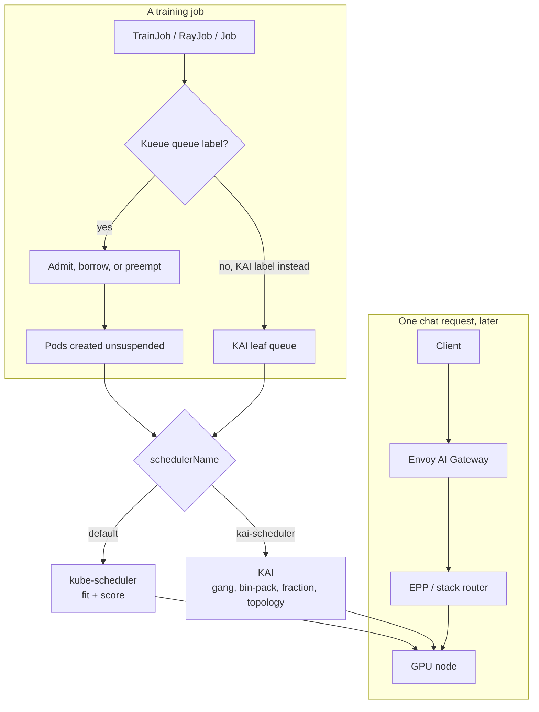

# 22 — Scheduling: who gets a GPU, and where it lands

Four different layers in this repo are casually called "the scheduler".
They answer different questions, and mixing them up is how jobs stay
Pending while a dashboard shows free GPUs.

| Layer | Question it answers | Object it binds | In this repo |
|---|---|---|---|
| **kube-scheduler** | Does this pod fit on a node right now? | one Pod | default for every workload that does not opt out |
| **Kueue** | May this *job* start, given quota, borrowing, and priority? | a Workload (the job stays suspended until yes) | `platform/09-kueue`. Default for TrainJob, RayJob, batch Jobs, LWS |
| **KAI Scheduler** | Which node, which GPU, and which team's fair share? | Pods that set `schedulerName: kai-scheduler` | `platform/10-kai-scheduler` |
| **Request router** | Which *replica* should this HTTP call hit? | one request | production-stack router, Inference Extension EPP, llm-d |

The last row never allocates `nvidia.com/gpu`. It only chooses among pods
that are already running. Docs 05 and 19 are about that row. This doc is
about the first three.



## 1. What kube-scheduler does by itself

kube-scheduler filters nodes (resource fit, taints, affinity) and scores the
rest (least allocated, spreading, and so on). It has no idea that two pods
are ranks of one NCCL job. It will start rank 0 on the last free GPU and
leave rank 1 Pending forever. Rank 0 then sits in `torchrun` rendezvous
until the job is killed. That is the "scheduler" bug behind most
multi-GPU hangs in a lab that has not turned on gang semantics.

It also has no team quota. The first manifest to arrive owns the GPUs until
it exits. A notebook and a pretrain job are equal.

Useful, and already in the cluster: node selectors and taints. This lab
keeps online vLLM on the default scheduler, on nodes you reserve for
serving, so a research queue cannot evict a live model. Reservation is a
node-pool decision. Queueing is Kueue or KAI.

## 2. Kueue: admission, then the default scheduler places

Kueue watches jobs, creates a Workload, and holds the job **suspended**
until the ClusterQueue has quota. On admit it unsuspends the pods and stamps
the ResourceFlavor's node labels as affinity. kube-scheduler then places
each pod. Kueue does the economics; placement stays with Kubernetes.

The sample in `platform/09-kueue/queues.yaml`, and the walk-through in
`kind/manifests/kueue-demo.yaml`:

* `training-cq` guarantees 4 GPUs. `batch-inference-cq` guarantees 2. They
  share cohort `ai-lab`, so either may borrow the other's idle GPUs.
* `reclaimWithinCohort: Any` means the lender preempts the borrower when it
  wants its guarantee back.
* A job labelled `kueue.x-k8s.io/priority-class: high` preempts `low` inside
  the queue.

Arithmetic for the demo, with fake GPUs so the quotas are the only limit:

| Step | Job | Asks | What the queue does |
|---|---|---|---|
| 1 | `low-a` | 4 GPU, priority low | Fits in the guarantee of 4. Admitted. |
| 2 | `low-b` | 4 GPU, priority low | 4 are taken. Borrowing can add the other queue's 2, which is 6, still short of 8. Stays pending. |
| 3 | `high-c` | 4 GPU, priority high | Preempts `low-a`, takes the 4-GPU guarantee. `low-b` stays pending. |

Watch it with `kubectl get workloads -n training -w`. The Workload status
(`Admitted`, `QuotaReserved`, `Preempted`, `Finished`) is the source of
truth; pod Pending events from kube-scheduler are downstream of that.

Cohort borrowing is why a cluster can stay full without giving every team a
hard slice that sits idle on weekends. The cost is preemption: a borrowed
GPU is a loan. Checkpoint often enough that losing the loan wastes minutes,
not a day. Online serving is left outside Kueue so it is never the thing
that gets preempted. See `platform/09-kueue/README.md` and docs/18.

Backfill is the other way to use those idle GPUs: reserve a start time for
the gang, and admit a smaller job only when its declared duration ends
before that time. Pods carry no duration, so this repo uses the preemption
above. The algorithm, and the same word applied to a free slot in a vLLM
batch, are [docs/24](24-scaling-inference.md).

`waitForPodsReady` (commented in `platform/09-kueue/values.yaml`) is Kueue's
gang knob: if any pod in the admitted job is still unscheduled when the
timeout hits, Kueue evicts the whole Workload and tries again. Turn it on
for multi-node training. Without it you are back to rank 0 running alone.

## 3. KAI: one scheduler that queues and places

KAI is what you add when the interesting question is placement, not just
admission. It opts in per pod (`schedulerName: kai-scheduler` plus a queue
label). The same cluster keeps kube-scheduler for everything else.

Hands-on files and the install live in
[`platform/10-kai-scheduler`](../platform/10-kai-scheduler/README.md). The
behaviours worth seeing, each with a manifest:

**Bin-pack.** Four 1-GPU pods on two 4-GPU nodes fill one node. The other
stays empty for a later gang that needs four GPUs side by side. Spread
places one pod per node and then cannot find two free GPUs on any single
node. Bin-pack is the lab default; `values-spread.yaml` flips GPU and CPU
placement together.

**Fractional GPUs.** `gpu-fraction: "0.5"` on two pods shares one device.
Two notebooks at half a GPU beat one notebook at a whole GPU and another
GPU powered off. The lab mode (`NonMemoryEnforced`) accounts for the
fraction and does not stop a process from allocating more memory than that.
HamiCore or NvFractions add a real cap. Fractional pods need a real GPU;
kind's fake `nvidia.com/gpu` is enough for whole-GPU examples only.

**Gang.** `kai.scheduler/batch-min-member` equal to `parallelism` holds
every pod until all of them fit. This is the direct fix for the rendezvous
hang in section 1. KAI builds the PodGroup for you for Jobs, JobSets, and
current KubeRay clusters.

**Queue tree.** A parent holds the pool (4 GPUs in the sample). Leaves
(`notebooks`, `distributed-training`, `offline-batch`) have a guarantee, a
limit, a priority, and an over-quota weight. Spare GPUs are split by
weight. A leaf with `limit: 1` cannot grow just because the cluster is
quiet — that is how you protect a training reservation from notebooks.

**Two priorities.** Queue priority orders teams. `priorityClassName` orders
jobs inside a team. The chart's classes `train` (50), `build` (100), and
`inference` (125) encode preemptibility: value 100 and above are not
preempted, and they may only run inside quota. Apply `examples/04-preemption-low.yaml` first and, once that pod is
Running, `examples/04-preemption-high.yaml`. Both use `notebooks`, whose
limit is one GPU, and the interactive pod takes the device from the
training pod.

**Topology.** A Topology CR lists node labels from coarsest to finest
(zone, rack, hostname, or an NVLink clique label). A job can require a
level and prefer a tighter one. KAI then picks the domain that fits the
whole gang and packs it downward. Tensor parallel wants the NVLink domain
as required. Data parallel can prefer a rack and cross the leaf switch when
the rack is full. The same idea in Kueue is Topology Aware Scheduling; at
hyperscale you want one of the two, aimed at the fabric you actually built
(docs/10).

## 4. A full day on 8 GPUs

Eight GPUs, two nodes of four. Serving is pinned to none of them in this
sketch (add a reserved node in a real lab). One researcher wants an
interactive notebook, one wants a 4-GPU training gang, one wants a pile of
1-GPU evals.

**kube-scheduler only.** The evals arrive first and take all 8. The gang
never sees four free GPUs on a node if the evals landed one per GPU across
both nodes. The notebook waits with no ETA. Nothing is wrong with any
single pod.

**Kueue, cohort of 8, training guarantee 4, batch guarantee 2, a third
queue borrowing.** The gang is admitted against the training guarantee and
kube-scheduler places it. Evals fill what is left, at low priority, and
lose those GPUs when the next training job shows up. You still depend on
kube-scheduler to co-locate the four gang members. With
`waitForPodsReady`, a placement that cannot complete rolls the admission
back. With Kueue TAS and rack labels, the four members prefer one node.

**KAI on the same 8, parent quota 8.** The gang goes to
`distributed-training` with `batch-min-member: 4` and bin-pack, so it
occupies one node. The notebook uses `gpu-fraction: "0.5"` on `notebooks`
and shares a GPU on the other node with a second notebook. Evals use
`offline-batch`, whole GPUs, low queue priority, and get preempted when
the training queue needs its guarantee back. One scheduler did quota,
gang, packing, and sharing.

Both Kueue and KAI can express "training owns 4, batch owns 2, notebooks
borrow". Run that policy in **one** of them per GPU. Doubling it admits
two jobs onto one device and the loser sits in `UnexpectedAdmissionError`
or a KAI fit error that looks like a capacity bug.

## 5. Choosing

| You want | Use |
|---|---|
| Upstream job APIs, MultiKueue across clusters, cohort lending, and placement left to kube-scheduler | **Kueue** (this repo's default for training) |
| Fractional GPUs, bin-pack, topology, and gang in the same component, on one cluster | **KAI** for those workloads |
| A batch-scheduler replacement with its own job CRDs, common in HPC-style shops | **Volcano** |
| Hierarchical queues as the main object, originally from YARN, strong multi-tenant fair share | **Apache YuniKorn** |
| Researchers already live in `sbatch` and you are not going to move them | **Slurm**, brought onto Kubernetes with **Slinky** (SchedMD) or **SUNK** (CoreWeave) |
| Per-request load and KV-cache placement | a **router** (docs/05), whichever job scheduler you picked |

Practical split used by the manifests here:

* Serving Deployments: kube-scheduler, reserved nodes or a higher pod
  priority, no queue label.
* TrainJob / RayJob / eval Jobs: Kueue, unless you are doing the KAI labs,
  in which case those jobs drop the Kueue label and set `schedulerName`.
* Notebooks that should share a GPU: KAI fractional queue, not a second
  replica of the whole device.

Volcano and YuniKorn are not installed. They solve the same admission
problem Kueue and KAI do, with their own CRDs, and a second batch scheduler
on a cluster that already has Kueue and KAI makes every "why is this
Pending?" question three tools wide. Learn the two that are in the tree,
then swap only if a feature you measured is missing. The usual missing
feature that pushes a lab to KAI is fractional GPU plus topology. The usual
missing feature that pushes a lab to stay on Kueue is MultiKueue.

## 6. Exercises

* **Lab 0.2** (docs/09) — Kueue preemption on kind with `kueue-demo.yaml`.
  Change `nominalQuota` from 4 to 2 and write down which Workload flips.
* **Lab 2.6** — KAI gang, then the same Job with `batch-min-member` removed.
  Time how long rank 0 sits running before you notice rank 1 never started.
* **Lab 2.7** — Four 1-GPU pods under bin-pack, delete them, upgrade with
  `values-spread.yaml`, submit again. Record the node of each pod.
* On a real GPU, **example 02**: two `gpu-fraction: "0.5"` pods. Check
  `nvidia-smi` in both and the reservation pod in
  `kai-resource-reservation`. Then read a CUDA OOM out of one of them and
  decide whether NonMemoryEnforced is acceptable for that tenant.

## 7. Commands that answer "why is it pending?"

```bash
# Kueue path
kubectl get workloads -A
kubectl describe workload -n training <name>

# KAI path
kubectl get queues.scheduling.run.ai
kubectl describe queue <leaf>
kubectl get podgroups -n training
kubectl describe pod -n training <name>          # KAI events are here

# Placement path, either scheduler
kubectl describe pod -n training <name> | sed -n '/Events/,$p'
kubectl get node -o custom-columns='NAME:.metadata.name,GPU:.status.allocatable.nvidia\.com/gpu'
```

Quota above real GPUs is the other classic: Kueue admits, kube-scheduler
then reports `Insufficient nvidia.com/gpu`, or KAI admits against a queue
limit the nodes cannot satisfy. Set nominal quotas and KAI parent quotas
from `kubectl get node` GPU counts, minus the cards reserved for serving.
