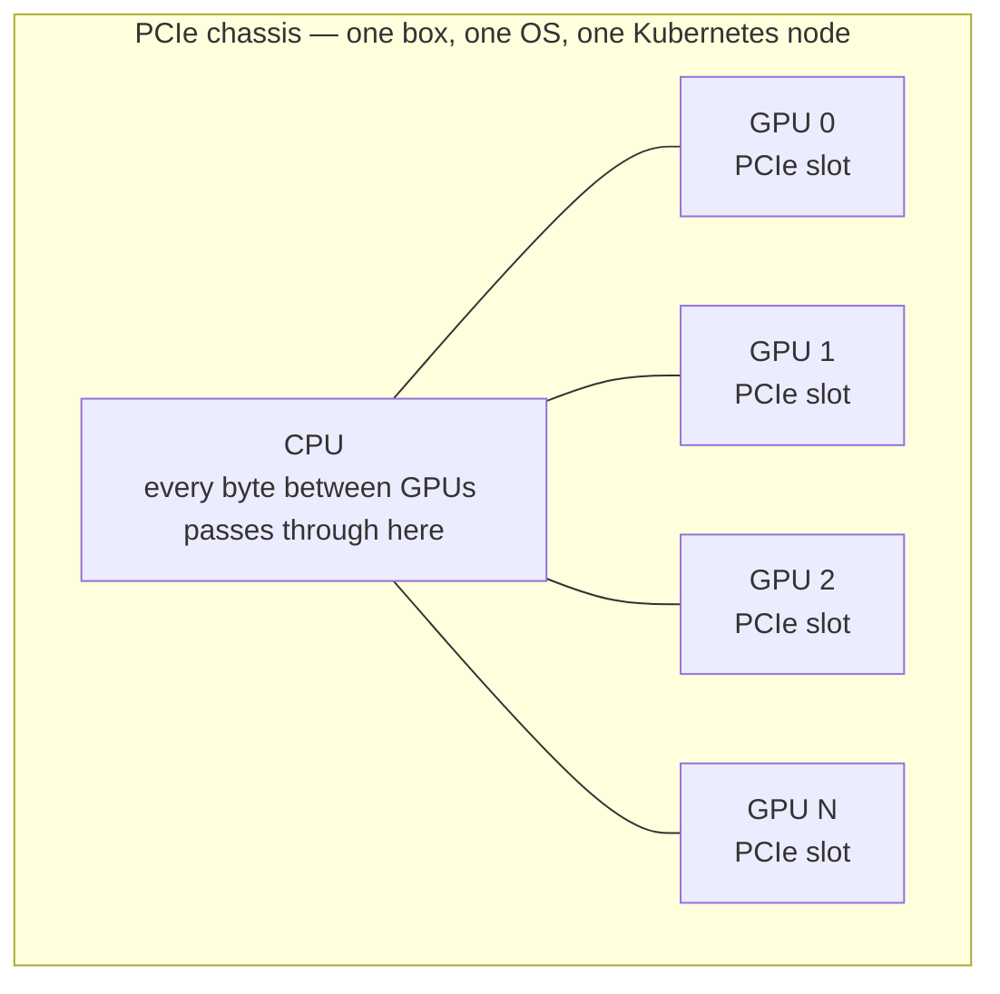
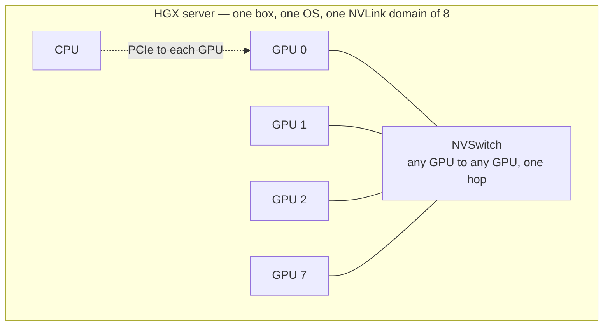
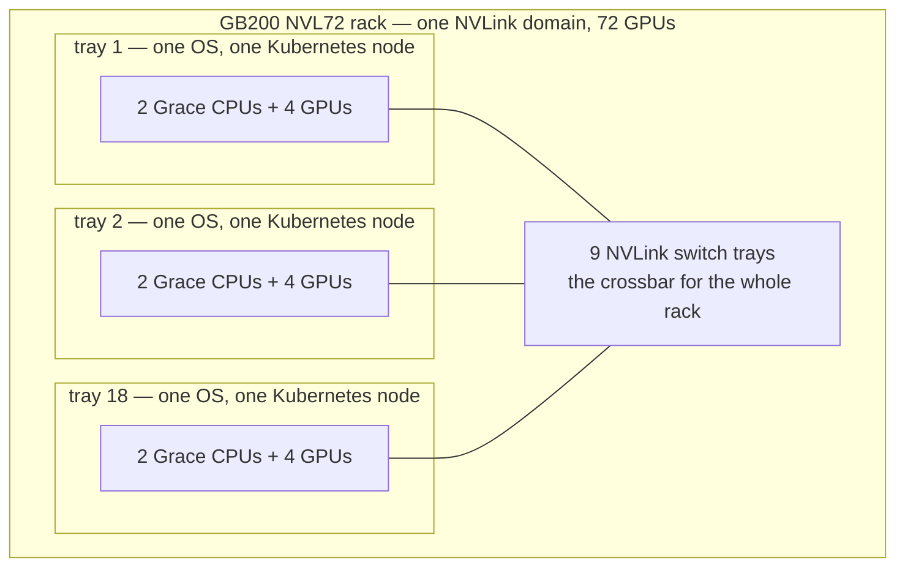
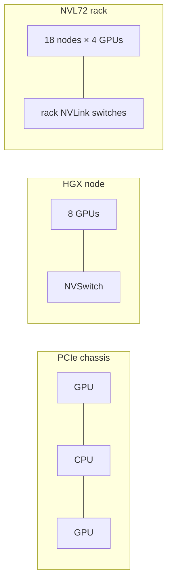
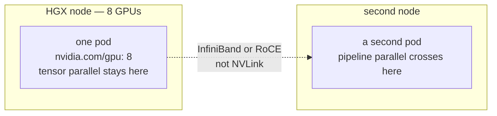

# 23 — How many GPUs one node can hold

Eight is the number of GPUs on one NVIDIA HGX baseboard. That board is the
server most labs buy, from A100 through Rubin NVL8, and it is the count
this repo's big-model manifests assume (`nvidia.com/gpu: "8"` on each
LeaderWorkerSet pod in [`platform/08-lws`](../platform/08-lws/README.md)).
A node holds as many GPUs as the chassis enumerates. The driver, the device
plugin, and the scheduler have no cap at 8.

Three different counts get called "GPUs per node". Keep them apart:

| Count | What it is | Typical value |
|---|---|---|
| **GPUs per OS** | devices one kernel and one kubelet see | 1, 4, 8, or 10 |
| **GPUs in one fast domain** | GPUs that can reach each other over NVLink or Infinity Fabric at full bandwidth | 8 on an HGX board; 72 on a GB200 NVL72 rack |
| **Schedulable GPUs** | `Allocatable nvidia.com/gpu` | the card count, or many more after MIG or time-slicing |

A pod's `nvidia.com/gpu` request is filled on **one** node. The kubelet
fills a container's devices from the machine that pod landed on. If the
largest node has 8 cards, a pod that asks for 9 stays Pending. Work that
needs more than one node is more pods: LeaderWorkerSet, JobSet, or
torchrun, one rank-group per node. That is what the 405B example does —
two pods, eight GPUs each, pipeline parallel between them.

## 1. PCIe chassis, NVLink domain, NVL72

These are three ways to wire GPUs together. The metal box, the fast
network between GPUs, and the Kubernetes node are three different
boundaries, and they only sometimes line up.

### PCIe chassis

A **chassis** is the metal box: the motherboard, the power supplies, the
fans. In a PCIe server the GPUs are cards in slots, the same way a NIC
or an NVMe drive is a card. **PCIe** is the bus on that motherboard.

Every slot's wires run to the CPU (or to a PCIe switch that itself runs
to the CPU). A tensor that has to move from GPU 0 to GPU 1 is copied out
to the CPU's side of the bus and back in to the other card. The GPUs have
no private road between them.



A PCIe Gen5 x16 slot is about 64 GB/s in one direction. That is plenty
for a model that fits on one card, and it is a tax on every layer when
one model is split across cards. This is the shape of a workstation, an
L4 or L40S inference server, and most boxes full of RTX cards. Some
data-center PCIe cards can bridge to exactly one neighbour (an H100 PCIe
pair). That pair is a tiny fast island. The rest of the cards in the box
still talk through the CPU.

Buy this when each replica uses one GPU. The number of cards in the box
is then just how many replicas fit in one node.

### NVLink domain

**NVLink** is NVIDIA's own link, separate from PCIe, with its pins on
the GPU module. An **NVLink domain** (also called a clique) is the set
of GPUs that can reach each other over those links.

On an HGX server the domain is a board inside the chassis. Eight SXM
modules — GPUs socketed onto the board, not pushed into PCIe slots — sit
on one PCB with **NVSwitch** chips. NVSwitch is a crossbar: every GPU
has links to the switch, so any GPU reaches any other GPU in one hop,
without the CPU. The CPU is still there. It loads the driver and the
model weights over PCIe. The all-reduce between GPUs does not use that
path.



The dotted link stands for a PCIe wire from the CPU to every GPU. That is
how weights get into GPU memory. The solid links are NVLink. An all-reduce
uses only those.

An H100's NVLink is about 900 GB/s per GPU. A B200's is about 1.8 TB/s.
The bandwidth is the headline. The topology is the reason tensor parallel
stays inside this set: every layer ends in an all-reduce, and that
all-reduce wants every participant on the switch. On an 8-GPU HGX board
the domain and the Kubernetes node are the same eight GPUs, which is why
people say "a node has 8 GPUs" and "TP=8" as if they were one fact.

AMD's MI300X board is the same picture with a different wire. Eight GPUs,
one box, one OS, and Infinity Fabric in the role NVSwitch plays here.

### HGX and DGX

HGX is the board. DGX is a finished computer NVIDIA sells with that board
inside.

NVIDIA does not sell an HGX board as a machine you rack. Server makers
(Dell, Supermicro, HPE, Lenovo, and others) take the 8-GPU baseboard —
eight SXM modules plus the NVSwitches — and build a chassis around it:
their CPUs, memory, NICs, disks, and power supplies. A Dell 8-GPU server
and a Supermicro 8-GPU server can both be an HGX H100 node. The kubelet
sees eight GPUs and one OS. It does not see the logo on the bezel.

DGX is NVIDIA's own name on a complete system. The GPU wiring inside a
DGX H100, DGX H200, or DGX B200 is one HGX board, so the node is still
8 GPUs in one NVLink domain. Choosing the DGX logo instead of an OEM
server changes the chassis, the NICs NVIDIA picked, DGX OS, and who you
call for support. It does not change `nvidia.com/gpu` or the manifests
in this repo.

| Name | What you are looking at | GPUs per OS |
|---|---|---|
| HGX 8-GPU board | the baseboard inside somebody's server | 8, once that server is built |
| DGX H100 / H200 / B200 | NVIDIA's server, one HGX board inside | 8 |
| DGX A100 | the same idea, previous generation | 8 |
| DGX-1 | NVIDIA's original 8-GPU server (P100, then V100) | 8 |
| DGX-2 | NVIDIA's 16× V100 server: two HGX-2 boards, one OS | 16 |
| DGX GB200 NVL72 | NVIDIA's packaged NVL72 rack. The unit is a GB200 tray, not an 8-GPU HGX board | 4 per tray |
| DGX Station | a desk-side workstation | a few GPUs, not a cluster node |

When this doc says "an HGX node", it means any server built on that
board, DGX included.

### GB200 NVL72

NVL72 takes the NVSwitch off the motherboard and makes it a set of
switch trays in a rack. The fast domain grows from 8 GPUs to 72. The
Kubernetes node does not.

The name is literal:

| Piece | Meaning |
|---|---|
| **GB200** | one Grace CPU bonded to two Blackwell GPUs (a superchip) |
| **NVL** | NVLink |
| **72** | GPUs in that one NVLink domain |

A compute **tray** is a 1U machine that slides into the rack. Each tray
holds two superchips: two Grace CPUs and four Blackwell GPUs, running
**one** OS. Eighteen trays hold 72 GPUs. Nine NVLink switch trays in the
middle of the rack wire every GPU to every other GPU. The rack is
liquid-cooled and draws on the order of 120 kW. NVL36 is the same tray
with a 36-GPU domain.



Kubernetes sees 18 nodes with 4 GPUs each. The NVLink domain sees 72
GPUs. A pod still lands on one tray, so it can request 4 GPUs. Using the
other 68 means more pods, placed on trays that share the domain, with
the fabric turned on for that job (section 4).

### The same job on each machine

| | PCIe chassis | HGX NVLink domain | GB200 NVL72 |
|---|---|---|---|
| What you bought | a server with GPU cards in slots | a server with an 8-GPU HGX board | a rack of trays plus switch trays |
| GPU-to-GPU path | through the CPU, over PCIe | NVSwitch on the board | NVLink switch trays in the rack |
| GPUs in the fast domain | 1, or a bridged pair | 8, and they are the node | 72, across 18 nodes |
| Kubernetes nodes | 1 | 1 | 18 |
| GPUs one pod can take | every card in the box | 8 | 4 |
| A model that fits on one card | one replica per card | one replica per card, or several cards for a bigger model | same, four cards per pod |
| A model that must be split | slow if the split crosses PCIe | tensor parallel inside the 8 | tensor parallel can cross trays, still on NVLink |



## 2. Shapes you will actually see

| Shape | GPUs per OS node | Fast domain | Notes |
|---|---|---|---|
| HGX 8-GPU (A100, H100, H200, B200, Rubin NVL8) | 8 | those 8, all-to-all over NVSwitch | the standard training and inference server |
| HGX 4-GPU | 4 | the board (often NVLink pairs) | smaller box, same software |
| PCIe server (L4, L40S, RTX, H100 PCIe) | 1–10 | PCIe; many cards have no NVLink to each other | fine for one replica per card |
| DGX-2 / HGX-2 (V100, historical) | 16 | 16 GPUs: two 8-GPU boards joined by NVSwitch | NVIDIA's server made from two HGX-2 boards |
| AMD Instinct MI300X | 8 | those 8, over Infinity Fabric | same "8" from a different board |
| GB200 NVL72 | **4** per tray | **72** across 18 trays | the rack is the NVLink domain; the node is not |
| kind lab | `FAKE_GPUS_PER_NODE` (default 4) | none | a status patch, no devices ([kind/README](../kind/README.md)) |

Hopper and later HGX boards are a single 8-GPU baseboard. The fabric
manager on H100 does not connect a second baseboard over NVLink, which is
why a modern HGX node stops at 8 even though the V100 generation shipped
16-GPU servers.

## 3. Why the HGX board is 8

The HGX baseboard puts eight SXM modules and their NVSwitches on one PCB
so every GPU talks to every other GPU at NVLink speed. Tensor parallel
wants that: an all-reduce on every layer, which is why
[docs/05](05-inference-deep-dive.md) and
[docs/06](06-training-deep-dive.md) keep TP inside the node and use
pipeline or expert parallel once the job crosses a machine.

Two physical budgets land on the same number:

* **PCIe lanes.** A dual-socket Xeon has 80 lanes per socket, 160 in the
  box. Eight GPUs at x16 consume 128 of them, and the rest go to NICs and
  NVMe. One EPYC has 128 lanes, which is exactly eight x16 slots. A 10-GPU
  chassis exists; it gets there with a second socket, x8 links, or a PCIe
  switch. GPU-to-GPU traffic then shares a narrower path, which is a poor
  fit for tensor parallel and a fine fit for eight or ten independent
  inference replicas.
* **Power.** An H100 or H200 SXM module is 700 W, so eight of them are
  5.6 kW before CPUs, NVSwitches, and NICs. A B200 module is about 1000 W,
  so the GPUs alone are 8 kW. An 8× H100 system, GPUs plus the rest of
  the chassis, is about 10 kW. Past that, power and cooling become a
  rack design, which is what NVL72 is.

Consumer cards follow the same constraints with less fabric. A 4090 has
no NVLink to its neighbours, and eight of them are a specialty PCIe
chassis with a switch on the motherboard. Each card is its own replica.

## 4. A pod still lands on one node

The pictures above change where the fast wires go. They do not change
the scheduling rule. One pod, one node, however many GPUs that node
advertises.



On HGX, the hop between those pods leaves the NVLink domain and uses the
network from [docs/03](03-hardware-and-cluster-prereqs.md). That is the
405B layout in [`platform/08-lws`](../platform/08-lws/README.md): TP=8
inside the pod, PP=2 across two pods.

On NVL72 the second pod can stay on NVLink, because the other trays are
in the same domain. The job is 18 pods of 4 GPUs, scheduled onto trays
that carry the same clique label (`nvidia.com/gpu.clique`). Kubernetes
does not join those nodes' NVLink by itself. A DRA `ComputeDomain`
tells the driver's IMEX daemon to open the cross-node links for that
job. One pod still cannot request 72. [docs/10](10-scaling-to-hyperscale.md)
is the hyperscale view of that placement. The device plugin's only job
is still to advertise the four GPUs on its own tray.

## 5. What the scheduler can hand out

Whole-GPU mode, the default in
[`platform/05-gpu-operator`](../platform/05-gpu-operator/README.md),
registers one `nvidia.com/gpu` per card. GPU Feature Discovery writes
`nvidia.com/gpu.count` with that card count. `kubectl describe node`
shows the same integer under Capacity and Allocatable.

MIG and time-slicing change the schedulable count and leave the cards
where they are:

| Mode | 8-GPU node advertises | Isolation |
|---|---|---|
| Whole GPU | 8 | one process family per card |
| MIG, `all-1g.10gb`, strategy `single` | 56 (`7 × 8`) | hardware memory and SMs per slice |
| Time-slicing, 4 replicas | 32 | none; shared memory |
| HAMi | memory and compute shares | software cap ([`platform/11-hami`](../platform/11-hami/README.md)) |

The MIG geometries and the `single` versus `mixed` strategies are in the
GPU Operator README. Kind never does this. `fake-gpus.sh` writes the
integer you pass into `status.capacity` (default 4, two nodes). The
container gets no device node either way.

## 6. Read it off the node

```bash
kubectl get nodes -L nvidia.com/gpu.product,nvidia.com/gpu.count,nvidia.com/gpu.memory
kubectl describe node <gpu-node> | sed -n '/Capacity/,/System Info/p'
```

On the node itself:

```bash
nvidia-smi -L            # one line per GPU the driver enumerated
nvidia-smi topo -m       # NV12 / NVLink vs PIX / PXB / SYS between pairs
```

`nvidia.com/gpu.count` should match `nvidia-smi -L` in whole-GPU mode.
Allocatable climbs above that count only after MIG or time-slicing.
`topo -m` is the picture that decides tensor parallel: pairs marked `NV`
share the fast domain; pairs marked `PIX`, `PXB`, or `SYS` cross PCIe
or the host, and an all-reduce across them runs at PCIe speed.

### Exercise 23.1 — the cap is the chassis
On kind:

```bash
cd kind
./fake-gpus.sh 8
kubectl get nodes -o custom-columns='NAME:.metadata.name,GPU:.status.allocatable.nvidia\.com/gpu'
./fake-gpus.sh 10
```

*Q: which number did the scheduler start enforcing, and which software
component refused to go past 8?* Both patches succeed. A real node is
different only because `nvidia-smi -L` returns the cards that are
plugged in. Compare that line count with `nvidia.com/gpu.count` after
the GPU Operator is up.

### Exercise 23.2 — domain versus node
On a GPU node, read `nvidia-smi topo -m`. *Q: can every GPU reach every
other GPU over NVLink, or only some pairs? If you set
`--tensor-parallel-size` equal to `nvidia.com/gpu.count`, which links
does that all-reduce use?* On an 8-GPU HGX board the answer is NVLink.
On a PCIe box it is the host. On an NVL72 tray the four local GPUs are
NVLink, and the other 68 GPUs in the domain sit on other nodes.
