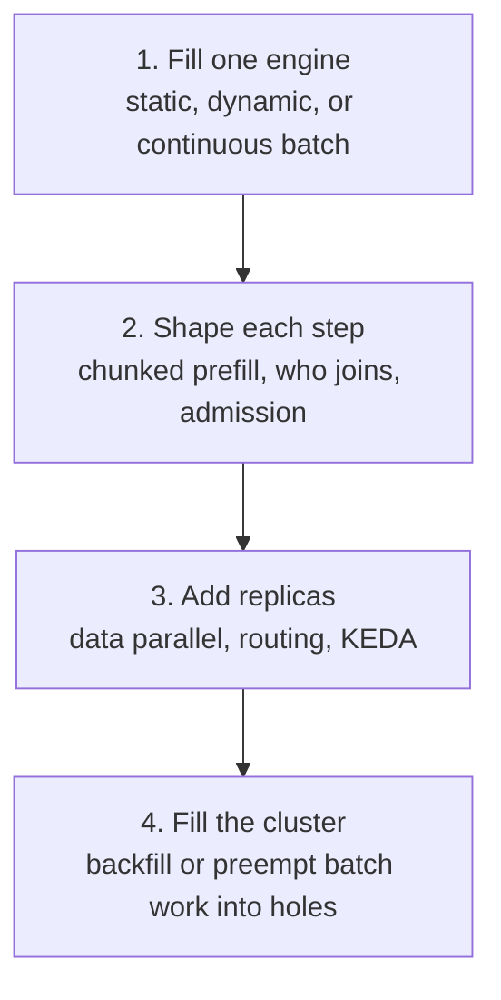

# 24 — Scaling inference: batching, backfill, and when to add a GPU

[docs/05](05-inference-deep-dive.md) names what an engine does.
[docs/18](18-capacity-planning-and-tenancy.md) turns an SLO into a GPU
count. [docs/22](22-scheduling.md) decides which job may occupy a GPU.
This doc is the layer between them: the algorithms that decide how full
that GPU stays, and how smaller work uses a hole. Read it before Lab 1.1.
The flags are the ones in `inference/02-vllm-basic`.

## The ladder

Scaling inference is four decisions, in this order. A later rung, done
first, buys GPUs to hide an idle batch.



| Rung | Question | Algorithm | Where it is set |
|---|---|---|---|
| 1 | Which requests share this forward pass? | continuous batching | `--max-num-seqs`, `--max-num-batched-tokens` |
| 2 | May one long prompt stall every stream? | chunked prefill | `--enable-chunked-prefill` |
| 3 | Which pod, and how many pods? | least-queue, prefix, KV-aware routing; KEDA | [docs/05](05-inference-deep-dive.md) §5, `inference/06-autoscaling` |
| 4 | May a waiting batch job use a free GPU? | backfill, or preemption | Kueue priority, [docs/22](22-scheduling.md) |

## 1. Three ways to build a batch

Four requests. A is short (about 20 output tokens). B is long (about 400).
C arrives while A and B are running. D arrives after A has finished and B
has not.

**Static batching.** Collect until N requests arrive or a window closes.
Run them as one closed group, padded to the longest sequence. Nobody joins
or leaves until the whole group finishes. The GPU waits at the start for
the window, then idle slots appear as the short sequences finish and the
long one continues. Embeddings, vision models, and a naive training step
still work this way. Chat lengths differ by 100× and arrive one at a time,
so the wait and the padding dominate.

**Dynamic batching.** The scheduler used by Triton (`max_queue_delay_microseconds`,
`max_batch_size`) and by TensorFlow Serving (`batch_timeout_micros`).
Requests that show up inside a short delay are grouped, then one forward
pass runs. A request that misses the window waits for the next group.
This fits stateless, similar-shaped calls: embeddings, rerankers, a Whisper
encoder, image models. For autoregressive decode the group is still closed
until the slowest sequence emits its last token, so the idle slots remain.
Dynamic batching decides when a batch **starts**. It does not rebuild the
batch **between tokens**.

Triton's *sequence* batcher is a third thing again: it keeps a slot per
stream so stateful models see their own history. That slot is not rebuilt
every token. Same word, different mechanism.

**Continuous batching.** Also called in-flight batching, or iteration-level
scheduling (Orca, OSDI 2022). The scheduler runs every step:

1. Sequences that emitted EOS, or hit their max tokens, leave. Their KV
   blocks return to the pool.
2. Waiting requests join if they fit in free KV blocks and in
   `--max-num-seqs`.
3. One forward pass runs. Each sequence advances one token (or a prefill
   chunk). Nothing is padded out to B.

```
step 1   A B
step 2   A B C     C joined the running batch
step 3   B C       A finished; its slot is free
step 4   B C D     D filled A's slot
```

Under static or dynamic batching, D waits until B finishes. Under
continuous batching, D runs on the next step. That fill — a waiting
request taking a hole at the next iteration — is the batch-level meaning
of **backfill**. Section 5 is the cluster-level meaning. They share a verb
and nothing else.

vLLM, SGLang, TensorRT-LLM (in-flight batching), and TGI all do this.
vLLM has no flag to turn it on. It is the scheduler. Blog posts that say
"dynamic batching" about vLLM almost always mean this, which is why the
Triton meaning and the vLLM meaning get confused in write-ups.

Speculative decoding ([docs/19](19-advanced-serving.md) §4) is still this
loop. A step may verify several drafted tokens for one sequence. The batch
is still rebuilt every step.

## 2. What caps the batch

Two budgets, plus memory:

| Budget | Flag | At the cap |
|---|---|---|
| Concurrent sequences | `--max-num-seqs` | further requests sit in `vllm:num_requests_waiting` |
| Tokens in this step | `--max-num-batched-tokens` | a prefill waits or is chunked; a decode is one token per sequence and usually fits |
| KV memory | `--gpu-memory-utilization`, `--kv-cache-dtype`, `--max-model-len` | admission stops even if the sequence count has room |

Memory binds first on long contexts. The bytes-per-token formula is in
[docs/05](05-inference-deep-dive.md). PagedAttention is what makes the free
slot in section 1 a real hole: KV is stored in fixed blocks and allocated
as tokens arrive, so a short chat does not hold a reservation the size of
`--max-model-len`. A scheduler that reserved the maximum up front would
report a full GPU while most of that reservation sat unused, and the
backfill in step 4 would have nowhere to go.

Raising `--max-num-seqs` raises tokens/s while the GPU is memory-bandwidth
bound, because one weight-read serves more sequences. The step gets slower
as the batch grows, so inter-token latency moves the other way. The knee
where tokens/s are still up and the ITL SLO still holds is **goodput**
(docs/05). Past it, a larger batch is the wrong scale-up. Lab 1.1 plots
that knee.

## 3. Chunked prefill

A 100k-token prefill in one step is a compute-bound pause. Every decode
in the batch waits, and ITL spikes. Chunked prefill (Sarathi-Serve) splits
that prefill into pieces of about `--max-num-batched-tokens` and mixes
those tokens with decode tokens in the same step. The batch is a token
budget, shared by new prompts and live streams.

One 100k prompt at 8192 tokens per step takes on the order of a dozen
steps, and the short chats keep receiving tokens during those steps. TTFT
for the long prompt grows a little, because its prefill is sliced. ITL for
everyone else stops tracking the longest prompt in the queue.

`--enable-chunked-prefill` is the flag this repo documents. On some vLLM
versions it is already the default; `vllm serve --help` on the pinned
image is the check. [docs/19](19-advanced-serving.md) §6 has the exercise.
Prefill/decode disaggregation (docs/19 §1) is the same split moved onto
separate GPU pools, once chunking inside one engine is not enough.

## 4. Which waiting request joins

Continuous batching says a hole may be filled. It does not pick the
request. Common policies:

| Policy | Rule | Where you meet it |
|---|---|---|
| FCFS | oldest waiting request | vLLM default (`--scheduling-policy fcfs` on builds that expose it) |
| Priority | interactive before batch, paid before free | gateway budgets and separate pools; some engines take a per-request priority |
| Shortest-first | small prompt, or few tokens left, jumps the queue | research schedulers (FastServe). Short chats get a better TTFT. A long RAG prompt can sit forever |
| Prefix-local | prefer a prompt whose blocks are already on this GPU | prefix caching, plus a router that sends the prompt to that GPU ([docs/05](05-inference-deep-dive.md) §5) |
| Adapter-local | group requests that share a LoRA | multi-LoRA kernels ([docs/19](19-advanced-serving.md) §7) |

FCFS plus a token budget is enough until one tenant's 30k-token prompts
sit at the head of the queue and everyone else's TTFT moves. That is
exercise 18.6. The levers that protect the short chats are a max prompt
length, a separate pool, or a priority applied before the engine queues
the call.

## 5. Backfilling free GPUs

Section 1 fills a hole in a **batch**. This section fills a hole in a
**cluster**.

A 4-GPU training gang is first in line. Two GPUs are free now. The other
two free up in 20 minutes. A scheduler that waits until the gang fits
leaves those two GPUs idle for 20 minutes. A scheduler that starts
whatever fits lets a 2-hour eval take them, and the gang waits 2 hours.
**Backfill** starts the small job only when the gang's start time stays
put.

**EASY backfill** (Lifka, 1995; Slurm's `SchedulerType=sched/backfill` is
this family) reserves a start time for the first job that cannot start
yet. Any other job may start now if its declared wall time fits in a hole
before that reservation. Later jobs have no reservation, so they can
leapfrog each other.

**Conservative backfill** reserves a start time for every waiting job. A
small job starts only if it delays nobody. Start times are more
predictable, and more GPUs sit idle.

Both need a duration. Slurm reads it from `#SBATCH --time`. An
underestimate is killed at the limit, which protects the reservation. An
overestimate never fits the hole, so the GPU stays idle. With no estimate
there is nothing to reserve against.

The 8-GPU day from [docs/22](22-scheduling.md). The gang is higher
priority and can start at T+20 min:

| Free now | Also waiting | EASY | Kueue or KAI, as installed here |
|---|---|---|---|
| 2 GPUs | 1-GPU eval, 5 min | eval runs; gang still starts at T+20 | eval runs |
| 2 GPUs | 1-GPU eval, 2 h | eval waits; it would miss the reservation | eval runs, and is preempted when the gang is admitted |

Pods do not carry a wall time, so Kueue and KAI do not implement EASY.
They fill idle quota immediately, and they protect the gang by
**preemption** (docs/22 §2 and §3). Preemption can spend the hole on work
that gets thrown away. EASY spends it on work that declared it would
finish. A borrowed GPU is a loan either way: checkpoint, or be cheap to
restart. Online serving stays off those queues so a live model is never
the loan.

Volcano runs a `backfill` action after higher-priority allocation, to fill
what those jobs left over. It does not need a wall time, so it is closer
to "use the leftovers" than to EASY. This repo does not install Volcano
or Slurm. A lab that already lives in `sbatch` gets textbook backfill by
bringing Slurm onto the cluster with Slinky or SUNK (docs/22 §5).

Offline batch inference is the workload those holes are for:
`apps/05-batch-api`, and the Ray batch jobs in `training/05-jobs`. It has
no TTFT SLO, it can restart, and it turns GPUs that serving and training
are not using into tokens. [docs/10](10-scaling-to-hyperscale.md) §6 is
the same tier at fleet scale: batch soaks idle GPUs and yields when
interactive load returns.

## 6. When another GPU is the right next step

Filling the batch has a ceiling. Read the metric, then move one rung.

| You see | The engine is | Next move |
|---|---|---|
| Waiting climbs, KV usage high, ITL still inside the SLO | full, memory-bound | another replica. KEDA on waiting requests and KV usage (`inference/06-autoscaling`). Data parallel, not a larger `--max-num-seqs` |
| ITL p99 spikes on long prompts, waiting stays low | busy with mixed prefill | chunked prefill, then a prefill/decode split ([docs/19](19-advanced-serving.md)) if the spike remains |
| TTFT high, prefix hit rate low, replicas already up | redoing the same prefill | prefix-aware or KV-aware routing (docs/05 §5) |
| Hot-model GPUs idle, a queue of batch and training jobs | waiting on gang or quota | preemption or backfill (section 5) |
| One replica's capacity C (docs/18) covers the peak | not full | leave the replica count alone. A new pod spends its cold start on a burst that is already over |

Cold start is 30 s–10 min (docs/05 §7). The replica you add after the
queue forms misses the burst that created the queue. `minReplicas ≥ 1` on
hot models, and the 0.7 factor in the docs/18 sizing formula, exist
because of that lag. Growing the batch on a replica that is already up is
immediate. Growing the replica count is not.

Tensor and pipeline parallel (docs/05 §3) are how one replica spans GPUs
when the weights do not fit on one card. They are a weak throughput plan
for an 8B that already fits. Lab 2.4 measures the difference. Pipeline
micro-batches in [docs/06](06-training-deep-dive.md) split a training step
across stages. They are not an inference batching policy.

Sharing one card across small models (MIG, time-slicing, HAMi, a KAI
fraction) multiplies schedulable devices and divides memory. That scales
the number of models, not the batch of one big model.
[docs/23](23-gpus-per-node.md), `platform/05-gpu-operator`,
`platform/11-hami`, `platform/10-kai-scheduler`.

## 7. Two-minute map

| You heard | It is | Read |
|---|---|---|
| Dynamic batching | a delay window, then a closed batch | §1 |
| Continuous / in-flight batching | rebuild the batch every step | §1, docs/05 |
| Batch backfill | a waiting request takes a free slot on the next step | §1 |
| Chunked prefill | a long prompt shares the step with live decodes | §3, docs/19 |
| PagedAttention | KV in blocks, so a finished sequence frees real memory | §2, docs/05 |
| EASY / conservative backfill | a small job takes a free GPU only if a reserved job still starts on time | §5 |
| Preemption | the small job runs, and is evicted when the reserved job can start | docs/22 |
| Goodput | tokens/s that still meet the SLO | docs/05, docs/18 |

## 8. Exercises

* **Lab 1.1.** `--max-num-seqs` 16, then 256, same `bench-random`. *Q:
  which has higher tokens/s, and which has worse ITL? At 16, did the extra
  requests show up as waiting or as a slower step?*
* Chunked prefill off, one 32k prompt beside four short chats, then on.
  *Q: did the short chats' gap between tokens move?*
* **Lab 0.2** (docs/22). With a low-priority job running, submit a 1-GPU
  job at low priority and a 4-GPU job at high priority. *Q: which of those
  is EASY backfill, and which is preemption? What would Slurm have needed
  on the manifest that Kueue does not ask for?*

## 9. Suggested reading

* Yu et al., *Orca* (OSDI 2022) — iteration-level scheduling.
* Kwon et al., the vLLM / PagedAttention paper — blocks so the batch can
  change every step.
* Agrawal et al., *Sarathi-Serve* (OSDI 2024) — chunked prefills.
* Lifka, *The ANL/IBM SP Scheduling System* (1995) — EASY backfill. Slurm's
  backfill plugin docs are the living version.
* Triton dynamic batcher docs, and TensorRT-LLM in-flight batching docs —
  the two vendor names for "batching" you will meet next.
