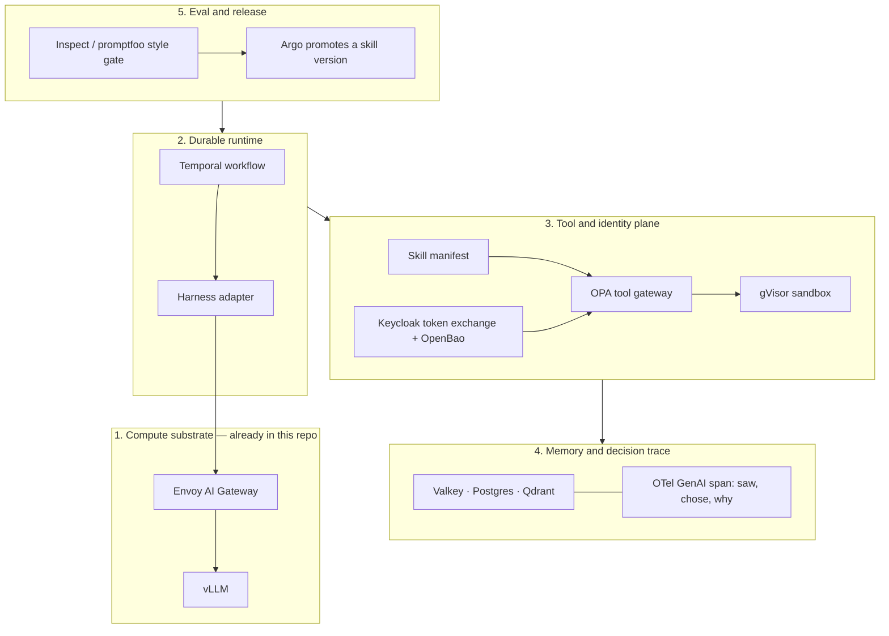
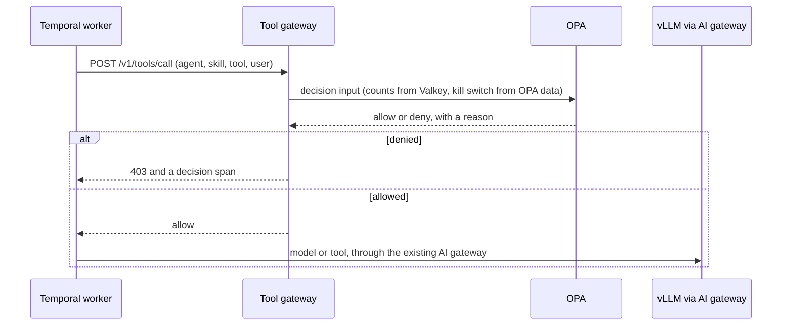

# 26 — An enterprise agent platform on this lab

The rest of this repo is the compute substrate: GPUs, model servers, quotas,
the AI gateway. This chapter is the control plane that sits on that
substrate and runs **agents**: long-lived processes that call tools against
real systems, for hours or weeks, on a person's behalf.

A chat completion is one request. An enterprise agent is a loop. It sees an
observation, chooses a tool, and the platform has to decide whether that
tool may run, whose credentials it runs with, where the side effect happens,
and how the run continues after a crash. Those decisions are the platform.
The model call is one step inside them.

Labs 01–10 under [`agents/`](../agents/README.md) install the open-source
pieces and leave a runnable example in each folder. Read this chapter once,
then install.

## Five layers



Layer 1 is [docs/05](05-inference-deep-dive.md), [docs/12](12-security.md)
and [`apps/04-agent-mcp`](../apps/04-agent-mcp/README.md). Layers 2–5 are
this chapter. An enterprise request reaches vLLM only after a blueprint, a
harness adapter, and the tool gateway have each had a say.

## One tool call

This is the path `agents/01` and `agents/02` implement. The later labs fill
in the boxes that are still fixed strings in that path.



The kill switch is a document in OPA (`data.agents.control.kill_switch`),
written by the platform, read on every call. The agent process has no API
that clears it. Budgets are counters the gateway increments. The client
cannot raise `max_steps` by putting a bigger number in the JSON.

Llama Guard, in [`security/06-ai-guardrails`](../security/06-ai-guardrails/README.md),
classifies prompt text. Kyverno admits pods. This gateway is the third
check: whether this **action** may run.

## What each lab adds

| # | Folder | You can show |
|---|---|---|
| 01 | [`agents/01-durable-runtime`](../agents/01-durable-runtime/README.md) | A workflow that resumes after the worker pod is deleted. Temporal dev server (SQLite + UI). |
| 02 | [`agents/02-tool-gateway`](../agents/02-tool-gateway/README.md) | Allow-list, step budget, repeat breaker, approval for `exec_code`, kill switch. |
| 03 | [`agents/03-credential-broker`](../agents/03-credential-broker/README.md) | Token exchange so the agent never holds the upstream secret. SPIRE is opt-in. |
| 04 | [`agents/04-sandbox`](../agents/04-sandbox/README.md) | A RuntimeClass for gVisor. The code-exec pod uses it. |
| 05 | [`agents/05-memory`](../agents/05-memory/README.md) | Working memory in Valkey, episodes in Postgres, semantic recall pointed at a separate Qdrant collection. |
| 06 | [`agents/06-skills`](../agents/06-skills/README.md) | `SKILL.md` manifests loaded as a ConfigMap. |
| 07 | [`agents/07-harness`](../agents/07-harness/README.md) | The same skill through two adapters, plus an A2A agent card for handoff. |
| 08 | [`agents/08-decision-traces`](../agents/08-decision-traces/README.md) | A decision span and Prometheus alerts for loops and token spend. |
| 09 | [`agents/09-eval-loop`](../agents/09-eval-loop/README.md) | A trajectory gate, then Argo annotates the promoted skill version. |
| 10 | [`agents/10-blueprint`](../agents/10-blueprint/README.md) | An `AgentBlueprint` CRD a team fills in. The controller is the thing you would write next. |

Install is optional. It is not part of `./scripts/install-all.sh all`,
because Temporal, Postgres and the worker are a second platform on the
same cluster.

```bash
# after the substrate you actually want (gateway and, for traces, monitoring)
./agents/install.sh
kubectl -n agents get pods
```

Each folder's `install.sh` also runs on its own. Image tags come from
[`versions.env`](../versions.env): `TEMPORAL_CLI_VERSION`, `OPA_VERSION`,
`VALKEY_VERSION`, `POSTGRES_VERSION`.

## Credentials, in one paragraph

The worker's ServiceAccount is the workload identity. When the tool needs
a human's permission, the broker (folder 03) performs OAuth token exchange
at Keycloak: the user's token goes in, a short-lived token scoped to that
one tool comes out, and the agent process never sees the client's secret
or a long-lived key in OpenBao. SPIRE, installed only with
`INSTALL_SPIRE=true`, is the workload-identity half of the same idea.

## What is still yours to build

The blueprint CRD does not reconcile. Applying `sre-agent.yaml` stores the
contract; folders 01–09 are what a controller would render from it. Claude
and Codex are external harnesses: folder 07 shows the adapter seam with
two local loops, which is the interface those harnesses would implement.
Production Temporal is the [temporalio helm chart](https://github.com/temporalio/helm-charts)
with Postgres, not `server start-dev`.

## Exercises

1. Start the workflow in folder 01. Delete the `agent-worker` pod mid-run.
   In the Temporal UI the completed activities stay completed and the run
   finishes on the new pod.
2. `./kill.sh on` in folder 02, then start another workflow. The activity
   fails with the kill-switch reason. `./kill.sh off` and it runs again.
3. Curl `exec_code` without `approval=granted`. Add the approval and omit
   the gVisor sandbox. Then set both and see the allow reason change.
4. Run `compare_harnesses.py` in folder 07. The tool sequence matches and
   the harness name does not.
5. Submit the skill-release workflow with `suite=pass`, then `suite=bad`.
   Only the first annotates `agent-skills`.
