# 27 — Inference Runtime and GPU Platform Knowledge Base

This chapter connects the mechanics of LLM inference with the infrastructure that operates it at scale.

The goal is to answer a practical question:

> When a request enters an AI platform, what happens from the API layer all the way down to the GPU, and which layer is responsible when latency, throughput, placement, networking, or reliability goes wrong?

This document focuses on the mental models that connect:

- request routing
- queues and admission control
- prefill and decode
- KV cache
- continuous batching
- speculative decoding
- inference scheduling
- Kubernetes scheduling
- GPU topology
- NCCL/RDMA fabrics
- autoscaling
- failures and draining
- fleet upgrades
- multi-tenancy

For deeper treatment of individual topics, see:

- [docs/05](05-inference-deep-dive.md)
- [docs/19](19-advanced-serving.md)
- [docs/22](22-scheduling.md)
- [docs/24](24-scaling-inference.md)
- [docs/25](25-kv-cache-prefill-decode.md)

---

## 1. The complete mental model

A useful way to reason about an AI inference platform is to separate it into five scheduling layers.

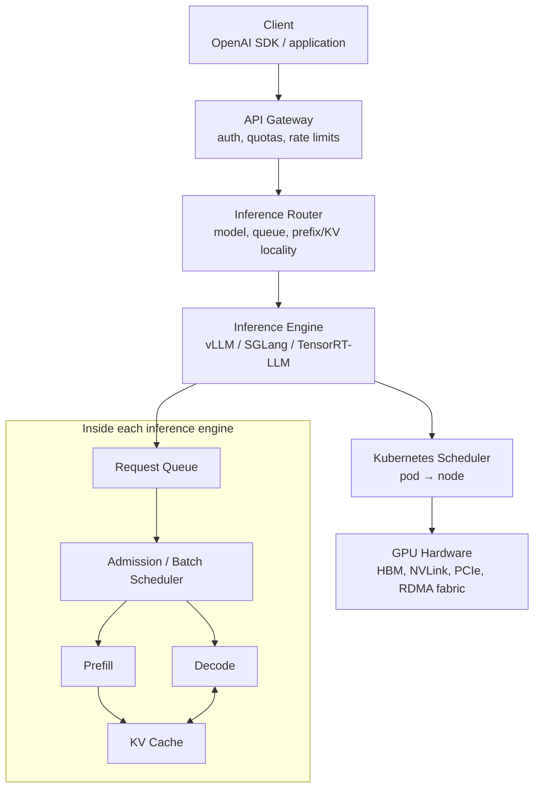

Each layer answers a different question.

| Layer | Main question |
|---|---|
| Gateway | Is this request allowed? |
| Router | Which model replica should receive it? |
| Inference scheduler | Which requests should share the next GPU step? |
| Kubernetes scheduler | Which node should run this inference pod? |
| GPU/runtime | How should kernels execute on the hardware? |

A common source of confusion is treating all of these as one scheduler.

They are not.

Kubernetes generally does **not** decide which user request runs next on a GPU. Once a vLLM pod owns a GPU, the vLLM runtime controls the request queue, batching policy, KV allocation, and token-generation loop.

---

## 2. End-to-end request path

Consider a user sending:

```text
"Explain Kubernetes in simple terms."
```

A simplified request flow is:

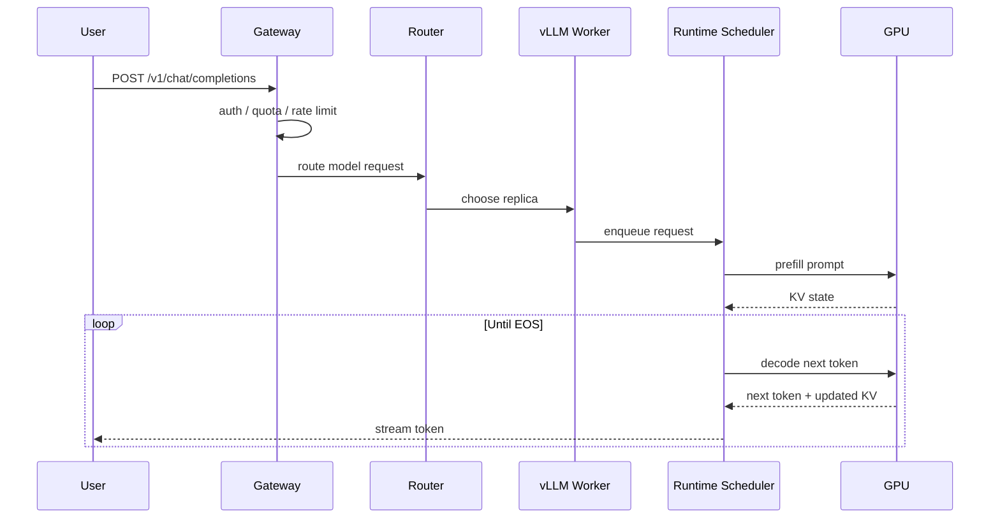

The important distinction is that the HTTP request does not map to one long GPU kernel.

Instead, inference is a sequence of GPU operations.

```text
request
   │
   ▼
tokenize
   │
   ▼
prefill
   │
   ▼
KV state exists
   │
   ├── decode token 1
   ├── decode token 2
   ├── decode token 3
   ├── ...
   └── EOS
```

During those decode steps, many other requests may be sharing the GPU.

---

## 3. Prefill and decode

Autoregressive inference has two very different phases.

## 3.1 Prefill

Prefill processes the input prompt.

For a 4,000-token prompt:

```text
token 1
token 2
token 3
...
token 4000
     │
     ▼
transformer forward computation
     │
     ▼
KV entries created for all prompt tokens
```

Characteristics:

- processes many tokens at once
- highly parallel
- usually compute-heavy
- creates KV cache
- determines much of **TTFT** — time to first token

A long prompt means more prefill work.

---

## 3.2 Decode

After prefill, the model generates output one token at a time.

```text
KV(prompt)
    │
    ▼
generate token 4001
    │
    ▼
append KV(4001)
    │
    ▼
generate token 4002
    │
    ▼
append KV(4002)
```

Characteristics:

- sequential across tokens for one request
- reuses KV cache
- often memory-bandwidth constrained
- strongly affects **ITL** — inter-token latency
- repeats until EOS or max-token limit

The dependency is:

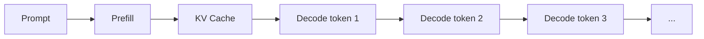

Decode cannot begin for a request until that request's prefill has created its initial KV state.

However, the GPU can interleave work from different requests.

---

## 4. What the KV cache actually contains

Self-attention computes:

```text
Q = query
K = key
V = value
```

For every previous token, later tokens need its K and V values.

Without caching:

```text
token 1001 generation
    ↓
recompute K/V for tokens 1..1000

token 1002 generation
    ↓
recompute K/V for tokens 1..1001
```

That would repeat enormous amounts of work.

With KV cache:

```text
GPU memory

┌─────────────────────────────────┐
│ Model weights                   │
├─────────────────────────────────┤
│ KV request A: tokens 1..1800    │
│ KV request B: tokens 1..500     │
│ KV request C: tokens 1..12000   │
│ free KV blocks                  │
└─────────────────────────────────┘
```

Only the new token's K/V needs to be produced and appended.

Conceptually:

```text
KV size per token
≈
2 × layers × KV heads × head dimension × bytes/value
```

The exact size depends heavily on architecture, especially whether the model uses:

- Multi-Head Attention
- Multi-Query Attention
- Grouped-Query Attention

This is why context length becomes an infrastructure concern.

A worker may have available compute while still being unable to admit another request because KV memory is exhausted.

---

## 5. Paged KV allocation

Naively reserving maximum context for every request wastes GPU memory.

Suppose the model supports 128k context but most requests use only 2k–8k tokens.

Bad model:

```text
Request A reserves 128k
Request B reserves 128k
Request C reserves 128k

actual usage:
A = 2k
B = 5k
C = 1k
```

Most memory is reserved but unused.

Paged KV systems allocate memory incrementally in blocks.

```text
KV block pool

[used A][used A][used B][free][free][used C][free][free]
```

As requests grow, they receive more blocks.

When a request finishes:

```text
before:
[A][A][B][B][C][C]

A finishes

after:
[free][free][B][B][C][C]
```

Those blocks can immediately be reused by another sequence.

This ability is fundamental to high-efficiency continuous batching.

---

## 6. Static, dynamic, and continuous batching

These terms are frequently confused.

## 6.1 Static batching

Wait for a fixed batch and run it together.

```text
Batch:
A B C D

A = 20 tokens
B = 400 tokens
C = 30 tokens
D = 100 tokens
```

The shorter requests finish early while the batch still contains the long request.

```text
time →

A ███
B ███████████████████████████
C ████
D ███████

unused batch slots:
    ↑      ↑
```

This is inefficient for interactive LLM traffic because sequence lengths vary dramatically.

---

## 6.2 Dynamic batching

Collect requests arriving within a short time window.

```text
t=0 ms   A arrives
t=1 ms   B arrives
t=3 ms   C arrives

batch window closes

GPU runs:
[A B C]
```

This works well for stateless requests such as:

- embeddings
- reranking
- image inference
- encoder models

But the batch is still generally formed before execution.

---

## 6.3 Continuous batching

For autoregressive LLM inference, the runtime rebuilds the active batch at every iteration.

Example:

```text
step 1: A B
step 2: A B C
step 3: B C
step 4: B C D
```

What happened?

```text
A and B running
      │
      ├── C arrives → joins
      │
      ├── A finishes → leaves
      │
      └── D arrives → fills A's freed capacity
```

A visualization:

```text
GPU step 1     [ A ][ B ]
GPU step 2     [ A ][ B ][ C ]
GPU step 3     [ B ][ C ]
GPU step 4     [ B ][ C ][ D ]
GPU step 5     [ B ][ C ][ D ][ E ]
```

The scheduler continuously asks:

```text
Which sequences are active?
Which finished?
How many KV blocks are free?
How many tokens fit in this step?
Which waiting requests can join?
```

This is sometimes called:

- continuous batching
- in-flight batching
- iteration-level scheduling

---

## 7. The inference scheduler loop

A simplified scheduler looks like this:

```text
while true:

    remove finished sequences

    reclaim their KV blocks

    inspect waiting queue

    admit requests that fit:
        sequence budget
        token budget
        KV budget

    build next GPU batch

    execute one model step

    append KV state

    stream generated tokens
```

Graphically:

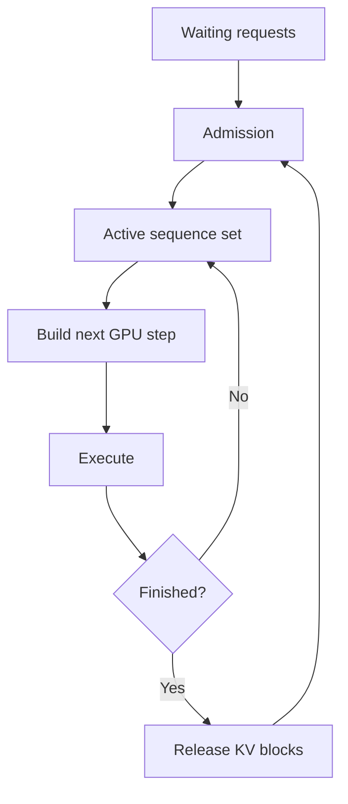

The scheduler is constantly balancing throughput against latency.

A larger batch generally improves GPU efficiency, but each GPU step takes longer.

That produces the classic tradeoff:

```text
batch size ↑
     │
     ├── throughput ↑
     │
     └── per-token latency may ↑
```

The goal is not maximum raw tokens/sec.

The goal is **goodput**:

> maximum useful throughput while latency SLOs remain satisfied.

---

## 8. What limits continuous batching

Three constraints commonly determine whether another sequence can join.

## Sequence limit

Example:

```text
max_num_seqs = 256
```

Even if memory exists, request 257 waits.

---

## Token budget

A GPU step may have a maximum number of scheduled tokens.

Example:

```text
max_num_batched_tokens = 8192
```

Decode usually contributes one token per active sequence.

Prefill may contribute thousands.

---

## KV memory

Even if sequence and token limits permit admission:

```text
free KV blocks = 0
```

means another long-context request cannot enter.

This is why queue depth alone is insufficient to understand saturation.

---

## 9. Why long prompts can hurt live decoding

Imagine:

```text
A = live chat currently decoding
B = live chat currently decoding
C = new 100k-token prompt
```

If the entire prefill for C monopolizes a large GPU step:

```text
A decode ───── waiting ───── decode
B decode ───── waiting ───── decode
C         [ massive prefill ]
```

Inter-token latency for A and B spikes.

---

## 10. Chunked prefill

Chunked prefill divides a large prompt into smaller pieces.

Instead of:

```text
[          100k-token prefill           ]
```

run:

```text
[8k prefill]
[decode + 8k prefill]
[decode + 8k prefill]
[decode + 8k prefill]
...
```

Visualization:

```text
GPU step 1:
A decode
B decode
C prefill chunk 1

GPU step 2:
A decode
B decode
C prefill chunk 2

GPU step 3:
A decode
B decode
C prefill chunk 3
```

Tradeoff:

```text
long request TTFT     slightly worse
existing streams ITL  much better
```

This is an example of optimizing fleet **goodput and fairness**, not one request in isolation.

---

## 11. Prefill/decode disaggregation

Prefill and decode stress GPUs differently.

```text
Prefill
  └─ high parallel compute

Decode
  └─ repeated weight/KV memory access
```

At sufficient scale, they can be separated into different worker pools.

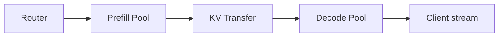

Potential benefits:

- independent scaling
- different GPU types for each phase
- fewer long-prefill stalls
- better utilization tuning

But there is a new cost:

```text
KV transfer
```

KV state may be large.

Disaggregation only helps when:

```text
benefit of specialization
>
KV transfer + operational complexity
```

Questions to evaluate:

- Is prefill compute-bound?
- Is decode memory-bandwidth-bound?
- How large is KV state?
- Is transport NVLink, PCIe, RDMA, or network?
- What is transfer latency?
- Is routing aware of P/D state?
- How are failures handled between phases?

---

## 12. Speculative decoding

Normal decoding is sequential:

```text
target model:
token 1 → token 2 → token 3 → token 4
```

A GPU can be underutilized because each step produces only one future token per sequence.

Speculative decoding introduces a smaller draft model.

```text
draft model:
A B C D

target model:
verify [A B C D] in parallel
```

If:

```text
A ✓
B ✓
C ✓
D ✗
```

the target model accepts A/B/C and resumes from the mismatch.

Conceptually:

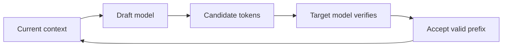

This trades:

```text
extra draft computation
```

for:

```text
fewer sequential target-model steps
```

It is most useful when the draft model predicts the target model well.

Continuous batching still exists around speculative decoding. The difference is that one scheduling iteration may verify multiple candidate tokens.

---

## 13. Router versus runtime scheduler

These two are easy to confuse.

## Router

Chooses a replica.

```text
request
   │
   ├── worker A
   ├── worker B
   └── worker C
```

Possible signals:

- queue depth
- model availability
- GPU type
- KV/prefix locality
- tenant
- adapter locality
- observed latency

---

## Runtime scheduler

Once a request reaches worker B:

```text
worker B queue
    │
    ▼
continuous batching
    │
    ▼
GPU steps
```

The runtime scheduler determines when the request enters the active batch.

Thus:

```text
router     = which engine?
scheduler  = when does it execute inside that engine?
```

A globally good routing decision can still produce poor latency if the destination engine's KV cache is nearly full.

---

## 14. KV-aware and prefix-aware routing

Suppose three replicas exist:

```text
GPU A: prefix cache contains "Kubernetes documentation..."
GPU B: no useful prefix
GPU C: no useful prefix
```

A new request shares a 20k-token prefix.

Naive routing:

```text
least connections → GPU B
```

Result:

```text
GPU B repeats 20k-token prefill
```

Prefix-aware routing:

```text
request → GPU A
```

Result:

```text
reuse cached prefix
skip/reduce prefill
```

Routing therefore becomes a locality problem.

Useful routing signals may include:

```text
queue depth
+
KV capacity
+
prefix locality
+
model residency
+
adapter residency
+
GPU health
```

Perfect global optimization is expensive, so practical systems use approximations.

---

## 15. Kubernetes scheduling versus inference scheduling

This distinction is foundational.

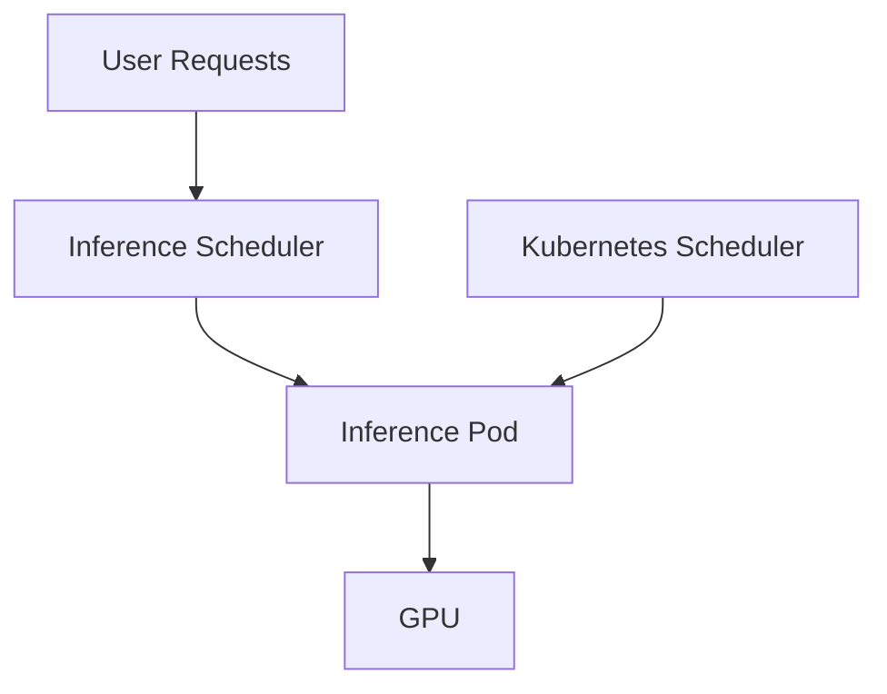

Kubernetes answers:

```text
Where should the inference worker pod run?
```

The inference runtime answers:

```text
Which requests should the worker run next?
```

Kubernetes operates at pod/node timescales.

Inference scheduling operates at token/millisecond timescales.

Trying to move every user request through Kubernetes would be far too slow.

---

## 16. GPU placement

GPU workloads add constraints beyond ordinary Kubernetes CPU workloads.

Placement may need to consider:

```text
GPU model
GPU memory
MIG configuration
NVLink topology
PCIe topology
NUMA locality
RDMA NIC locality
node health
driver/CUDA version
model size
tensor-parallel width
```

Example:

```text
Model needs tensor parallel = 8

Node A:
8 × H100
NVLink-connected
→ ideal

Nodes B + C:
4 × H100 each
network only
→ possible, but expensive communication
```

A scheduler that sees only:

```yaml
resources:
  limits:
    nvidia.com/gpu: 8
```

may miss important topology.

---

## 17. Tensor parallelism and topology

A large model may not fit on one GPU.

Tensor parallelism splits model operations across GPUs.

```text
GPU0 ─┐
GPU1 ─┤
GPU2 ─┼── one model replica
GPU3 ─┘
```

Each layer can require collective communication.

The communication path matters enormously.

Typical preference:

```text
same GPU
  ↓
NVLink / NVSwitch
  ↓
same host PCIe
  ↓
RDMA / InfiniBand between hosts
  ↓
ordinary TCP network
```

As communication gets slower, inference efficiency drops.

This is why placement must understand topology rather than simply GPU count.

---

## 18. NCCL and the communication fabric

NCCL implements GPU collectives such as:

```text
all-reduce
all-gather
reduce-scatter
broadcast
```

These appear heavily in:

- tensor parallelism
- distributed training
- some pipeline/model-parallel configurations

Conceptual topology:

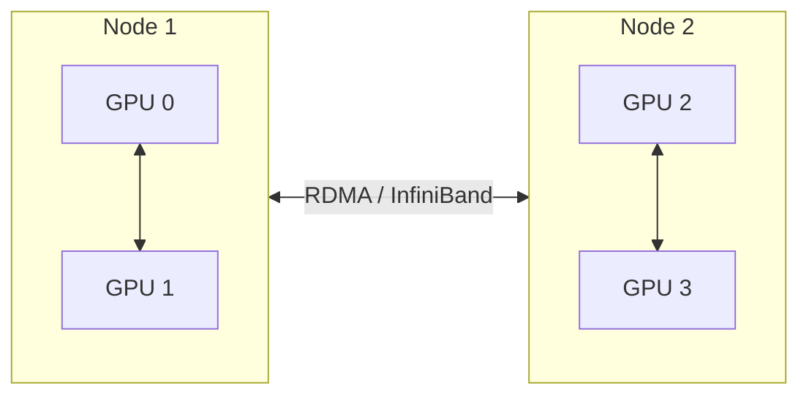

Important questions:

```text
Are GPUs talking over NVLink when they should?
Are cross-node collectives using RDMA?
Is traffic falling back to TCP?
Are GPUs and NICs NUMA-local?
Is oversubscribed network fabric limiting scaling?
```

Poor topology can make a cluster look GPU-starved when the actual problem is communication.

---

## 19. Are the GPUs actually saturated?

GPU utilization alone is not enough.

A GPU may report high utilization while useful token throughput remains poor.

A better view combines several layers.

## Engine metrics

```text
requests waiting
requests running
KV cache utilization
prefill tokens/sec
decode tokens/sec
TTFT
ITL
end-to-end latency
batch size
prefix-cache hit rate
```

## GPU metrics

```text
SM utilization
HBM utilization
memory bandwidth
GPU memory used
power
temperature
throttling
XID errors
```

## Infrastructure metrics

```text
pod pending time
node provisioning time
RDMA throughput
NCCL latency
network retransmits
model download time
```

A simplified diagnostic matrix:

| Observation | Likely issue |
|---|---|
| GPU low, queue high | scheduler/configuration/data starvation |
| GPU high, tokens/sec poor | memory bandwidth, topology, kernel inefficiency |
| KV near full, GPU compute moderate | context/KV bottleneck |
| TTFT high, ITL good | queue or prefill bottleneck |
| TTFT good, ITL high | decode saturation |
| multi-node scaling poor | NCCL/fabric/topology |
| replicas idle but one queue hot | routing imbalance |

---

## 20. Backpressure

An inference service should not accept unlimited work.

Without backpressure:

```text
incoming request rate
        >
service capacity

queue
  ↓
grows forever
  ↓
TTFT explodes
  ↓
timeouts
  ↓
retries
  ↓
more traffic
  ↓
collapse
```

This positive feedback loop is dangerous.

Use bounded queues and admission control.

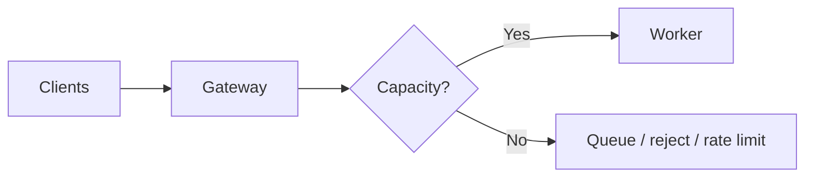

Possible controls:

- maximum queue depth
- tenant rate limits
- token budgets
- request deadlines
- maximum prompt length
- maximum output length
- concurrency limits
- overload rejection

Returning a fast overload response can be healthier than accepting a request that will time out thirty seconds later.

---

## 21. Autoscaling inference

CPU-style autoscaling often fails for LLM inference.

CPU usage is not the main demand signal.

Better signals include:

```text
waiting requests
KV cache pressure
tokens waiting
TTFT
active sequences
token throughput
```

Conceptually:

```text
queue grows
   │
   ▼
autoscaler requests new replica
   │
   ▼
Kubernetes schedules pod
   │
   ▼
node may need provisioning
   │
   ▼
container starts
   │
   ▼
model weights load
   │
   ▼
worker becomes ready
```

The important issue is lag.

```text
request burst:         seconds
model cold start:      tens of seconds to minutes
new GPU node:          minutes
```

Reactive autoscaling cannot solve every burst.

Useful strategies:

- maintain warm replicas
- predictive scaling for known traffic patterns
- pre-provision GPU nodes
- cache model weights locally
- separate hot models from cold models
- scale on queue/KV metrics rather than CPU

---

## 22. How Kubernetes autoscaling interacts with runtime batching

Continuous batching should usually absorb short-term variation first.

Think of capacity expansion as a ladder:

```text
1. Fill existing GPU batch
        ↓
2. Use available KV memory
        ↓
3. Add another model replica
        ↓
4. Add another GPU node
        ↓
5. Add capacity in another cluster
```

A runtime can react in milliseconds.

A pod autoscaler reacts in seconds.

A node provisioner reacts in minutes.

A multi-cluster capacity action may take even longer.

Therefore the fastest control loop should handle the fastest variation.

---

## 23. GPU/node failure

Assume an inference pod is running on:

```text
Node A
GPU 3
```

GPU 3 begins producing hardware errors.

Desired response:

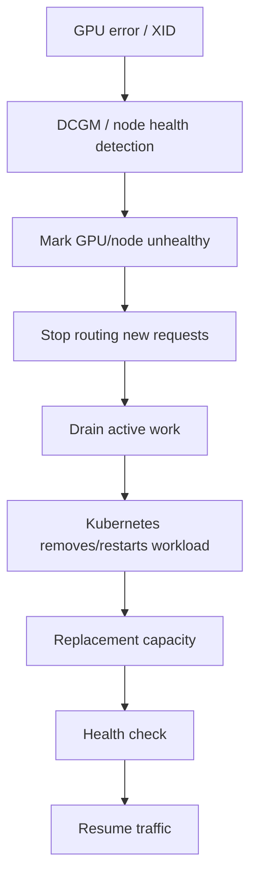

Not every failure permits graceful draining.

A hard GPU reset may destroy:

```text
active request state
KV cache
loaded model memory
```

Clients therefore need appropriate retry semantics.

The platform should distinguish:

```text
planned drain
vs
hardware failure
```

---

## 24. Graceful draining without destroying useful KV state

For a planned node maintenance event:

Bad drain:

```text
kubectl delete pod
```

All active generation disappears immediately.

Better sequence:

```text
1. mark worker unavailable for new requests
2. keep existing streams running
3. wait for active sequences to finish
4. enforce maximum drain deadline
5. terminate remaining work
6. evict pod
```

Visualization:

```text
time →

new traffic:   XXXXX blocked XXXXX
existing A:    ███████ done
existing B:    ███████████ done
existing C:    ███████████████ deadline
                                     │
                                     ▼
                                  terminate
```

KV state is usually ephemeral.

Moving it live to another GPU may cost more than simply finishing existing requests.

Large shared/disaggregated KV systems change that tradeoff, but migration is not free.

---

## 25. Model loading and cold starts

Starting an inference replica includes more than pod creation.

```text
schedule pod
   ↓
pull image
   ↓
mount storage
   ↓
load model weights
   ↓
initialize CUDA
   ↓
allocate KV cache
   ↓
compile/capture kernels/graphs
   ↓
health check
   ↓
ready
```

For very large models, model loading may dominate startup.

At scale, improve this with:

- local model caches
- image pre-pulling
- fast object storage
- peer-to-peer model distribution
- warm pools
- staggered rollouts

A pod reported as "Running" is not necessarily ready to serve useful inference.

---

## 26. Fleet-wide GPU driver and CUDA upgrades

At hundreds of clusters, an upgrade should be treated as a rollout problem rather than a package update.

Compatibility chain:

```text
hardware
   ↓
firmware
   ↓
kernel
   ↓
NVIDIA driver
   ↓
CUDA runtime
   ↓
NCCL
   ↓
inference engine
   ↓
model kernels
```

A safe rollout:

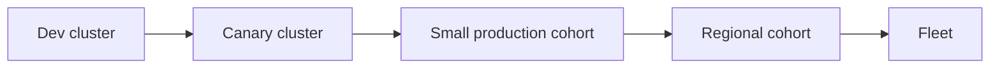

At each stage verify:

```text
GPU health
model startup
NCCL collectives
token throughput
TTFT/ITL
error rate
XID events
memory behavior
```

A fleet controller/GitOps system should know:

```text
desired version
current version
upgrade cohort
health state
rollback version
```

Do not upgrade all clusters simultaneously.

---

## 27. GPU-type placement

Different workloads may prefer different accelerators.

Example:

```text
large prefill workload
    → high compute throughput

long-context decode
    → memory capacity/bandwidth

small model
    → cheaper GPU may be sufficient

giant tensor-parallel model
    → strong NVLink/NVSwitch topology
```

Routing and scheduling should therefore treat:

```text
"GPU"
```

as insufficiently specific.

Instead, model resources such as:

```text
GPU architecture
HBM size
NVLink availability
MIG profile
RDMA connectivity
cost
```

The correct GPU is a workload property.

---

## 28. Multi-tenancy

Without isolation:

```text
Tenant A sends 1,000 long-context requests
        ↓
KV fills
        ↓
queue grows
        ↓
Tenant B's short requests suffer
```

Useful controls exist at several levels.

## Gateway

```text
requests/sec
tokens/minute
prompt length
output length
```

## Runtime

```text
priority
queue classes
max concurrency
separate worker pools
```

## Kubernetes

```text
ResourceQuota
Kueue quota
PriorityClass
namespace isolation
```

## Network/security

```text
NetworkPolicy
identity
secret boundaries
```

Fairness should often be measured in tokens or GPU time, not merely request count.

One 100k-token request is not equivalent to one 100-token request.

---

## 29. Request priority

Suppose the queue contains:

```text
A: interactive chat
B: offline summarization
C: interactive chat
D: batch evaluation
```

Pure FCFS:

```text
A → B → C → D
```

can let batch work increase user latency.

A production platform may instead separate traffic classes.

```text
interactive
    │
    ├── priority queue
    │
batch
    └── opportunistic capacity
```

Offline workloads are particularly useful for absorbing idle GPU capacity because they can:

- wait
- checkpoint
- restart
- tolerate preemption

---

## 30. One request versus one GPU

A common incorrect model is:

```text
one request
    =
one GPU
```

A better model is:

```text
                    ┌─ request A
                    ├─ request B
one inference GPU ← ├─ request C
                    ├─ request D
                    └─ request E
```

The runtime multiplexes many active sequences through repeated GPU steps.

Conversely, one model replica may require many GPUs:

```text
one replica
    =
8 GPUs
```

because tensor parallelism is required for the model to fit.

Thus:

```text
request count
model replica count
GPU count
```

are three different quantities.

---

## 31. One model replica versus many replicas

Suppose an 8B model fits on one GPU.

Throughput scaling can use independent replicas:

```text
Replica A → GPU 0
Replica B → GPU 1
Replica C → GPU 2
Replica D → GPU 3
```

The router load-balances requests.

For a model requiring TP=4:

```text
Replica A → GPUs 0,1,2,3
Replica B → GPUs 4,5,6,7
```

The scheduling unit for routing is still the replica, not the individual GPU.

---

## 32. Single-node versus multi-node inference

Prefer keeping a replica inside one node when possible.

```text
single node
GPU0 -- NVLink -- GPU1 -- NVLink -- GPU2
```

When the model is too large:

```text
Node A GPUs
     │
  RDMA/NCCL
     │
Node B GPUs
```

Now inference availability depends on:

```text
both nodes
network fabric
NCCL
RDMA NICs
topology
```

Multi-node inference should therefore be used because the model or throughput requires it, not simply because GPUs happen to be available across two machines.

---

## 33. Common failure patterns

## Queue explosion

Symptoms:

```text
waiting requests ↑
TTFT ↑
GPU already busy
```

Likely action:

```text
add capacity
or
shed load
```

---

## KV exhaustion

Symptoms:

```text
KV utilization near 100%
requests waiting
GPU compute not necessarily 100%
```

Possible actions:

```text
reduce max context
increase KV capacity
use lower-precision KV
add replicas
improve prefix reuse
```

---

## Long-prefill interference

Symptoms:

```text
ITL spikes when large prompts arrive
```

Possible actions:

```text
chunked prefill
traffic classes
prefill/decode disaggregation
```

---

## Poor multi-GPU scaling

Symptoms:

```text
GPU count doubles
throughput barely improves
```

Investigate:

```text
NCCL
NVLink
RDMA
PCIe
NUMA
tensor-parallel communication
```

---

## Replica imbalance

Symptoms:

```text
worker A queue = 100
worker B queue = 2
worker C queue = 0
```

Investigate:

```text
router policy
stale metrics
prefix affinity
failed readiness updates
sticky sessions
```

---

## 34. Troubleshooting decision tree

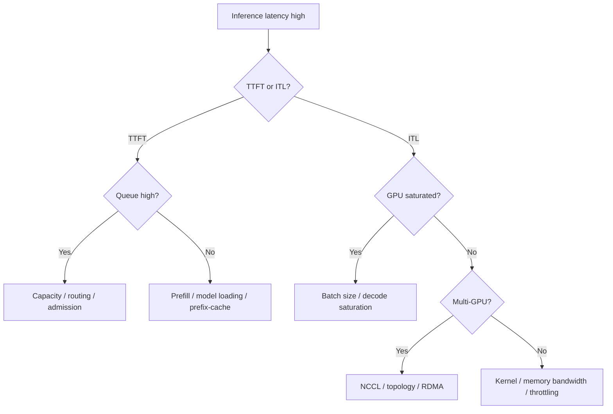

A more operational version:

```text
high latency
│
├── TTFT high
│   ├── waiting queue high → capacity problem
│   ├── huge prompts → prefill problem
│   ├── low prefix hits → locality problem
│   └── cold replicas → startup problem
│
└── ITL high
    ├── large active batch → decode saturation
    ├── long prefills interfering → chunking problem
    ├── multi-GPU communication → topology/NCCL
    └── HBM bandwidth pressure → GPU/runtime
```

---

## 35. Capacity planning from requests to GPUs

A useful capacity-planning chain is:

```text
requests/sec
    ↓
prompt tokens/sec
    +
output tokens/sec
    ↓
runtime throughput per replica
    ↓
replicas required
    ↓
GPUs per replica
    ↓
total GPUs
```

Example:

```text
traffic:
20 requests/sec

average:
1,000 input tokens
300 output tokens

input:
20,000 prompt tokens/sec

output:
6,000 decode tokens/sec
```

But averages are not enough.

Capacity should account for:

```text
p95 prompt length
p95 output length
burstiness
TTFT target
ITL target
KV capacity
failure headroom
cold-start time
```

A fleet that runs at 100% theoretical capacity has no room for:

```text
failures
traffic bursts
rolling upgrades
imbalanced routing
```

Therefore production sizing intentionally keeps headroom.

---

## 36. Control loops at different timescales

AI infrastructure contains nested control loops.

```text
microseconds–milliseconds
    GPU kernels

milliseconds
    continuous batching

milliseconds–seconds
    inference routing

seconds
    pod autoscaling

minutes
    node provisioning

minutes–hours
    cluster/fleet capacity management
```

A useful rule:

> Solve fast problems with fast control loops.

For example:

Do not provision a new GPU node because one 300 ms burst temporarily filled the request queue.

Likewise, continuous batching cannot solve sustained demand that exceeds total fleet capacity.

---

## 37. Where a Kubernetes platform fits

A Kubernetes AI platform typically owns capabilities around the inference engine rather than replacing the engine.

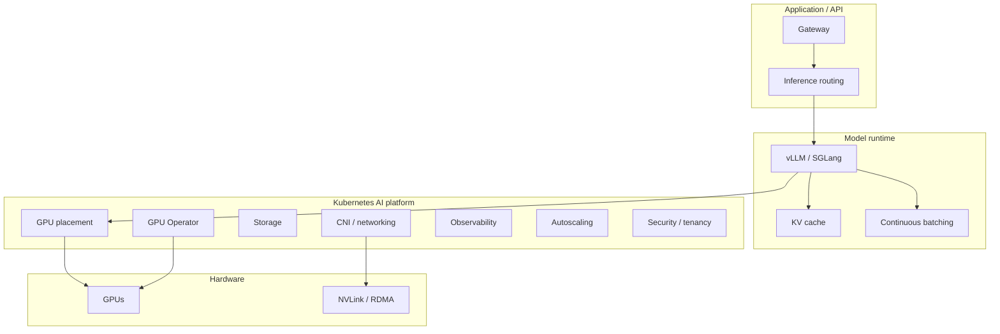

Typical platform responsibilities include:

- cluster lifecycle
- GPU discovery
- GPU health
- node lifecycle
- drivers and CUDA compatibility
- networking
- RDMA configuration
- topology-aware scheduling
- quotas
- autoscaling infrastructure
- observability
- upgrades
- multi-cluster capacity

The inference engine owns:

- token scheduling
- continuous batching
- KV allocation
- model execution
- decoding algorithms

The two layers meet through metrics, resource contracts, topology, and lifecycle APIs.

---

## 38. Questions to ask when designing an inference platform

## GPU utilization

```text
Are GPUs actually saturated?
Is the bottleneck compute, HBM bandwidth, KV capacity, or networking?
```

## Placement

```text
Are workloads landing on the correct GPU type?
Does a TP group stay within the best available topology?
```

## Prefill/decode

```text
Are long prefills damaging ITL?
Would chunking fix it?
Is P/D disaggregation justified?
```

## Networking

```text
Are we crossing nodes unnecessarily?
Is NCCL using the intended fabric?
Is RDMA healthy?
```

## Capacity

```text
How quickly can another ready replica appear?
How quickly can another GPU node appear?
Are model weights already local?
```

## Failure handling

```text
What happens when one GPU fails?
Can a node drain gracefully?
What state is lost?
What will the client retry?
```

## Autoscaling

```text
Which metrics trigger scaling?
Can continuous batching absorb the burst first?
Does scale-up happen before the burst is already over?
```

## Fleet operations

```text
How do driver/CUDA/NCCL upgrades roll across clusters?
What is the canary strategy?
What metrics automatically halt rollout?
```

## Tenancy

```text
Can one tenant consume all KV memory?
Can one tenant monopolize the queue?
Are quotas based on requests or tokens?
```

These questions connect the model-runtime layer to the Kubernetes and fleet-management layer.

---

## 39. A compact inference mental model

If only one diagram is remembered, use this one:

```text
                         ┌───────────────┐
request ── gateway ─────►│ replica router│
                         └───────┬───────┘
                                 │
                                 ▼
                         ┌───────────────┐
                         │ request queue │
                         └───────┬───────┘
                                 │
                                 ▼
                      ┌────────────────────┐
                      │ continuous batcher │
                      └─────────┬──────────┘
                                │
                  ┌─────────────┴─────────────┐
                  │                           │
                  ▼                           ▼
               prefill                     decode
                  │                           │
                  └─────────────┬─────────────┘
                                ▼
                            KV cache
                                │
                                ▼
                              GPU
                                │
                ┌───────────────┴───────────────┐
                │                               │
             NVLink/RDMA                    metrics
                │                               │
                ▼                               ▼
          other GPUs/nodes              autoscaling/routing
```

And remember the ownership boundaries:

```text
Kubernetes:
pod → node → GPU

Inference runtime:
request → batch → token

Router:
request → replica

Fleet manager:
cluster → capacity → lifecycle
```

---

## 40. Terminology cheat sheet

| Term | Meaning |
|---|---|
| Prefill | Process prompt and create initial KV state |
| Decode | Generate output autoregressively |
| KV cache | Stored attention K/V values for previous tokens |
| TTFT | Time from request arrival to first generated token |
| ITL | Time between generated tokens |
| Continuous batching | Rebuild active batch every inference iteration |
| Dynamic batching | Group arrivals within a batching window |
| Chunked prefill | Split large prefill into smaller scheduled chunks |
| PagedAttention | Block-based KV memory management |
| Prefix cache | Reuse KV for previously computed prompt prefixes |
| Speculative decoding | Draft multiple candidate tokens and verify them |
| Tensor parallelism | Split model computation across GPUs |
| NCCL | GPU collective communication library |
| RDMA | Direct high-speed network data transfer |
| Goodput | Throughput delivered while meeting latency objectives |
| Admission control | Decide whether new work may enter |
| Backpressure | Prevent incoming demand from overwhelming capacity |
| P/D disaggregation | Run prefill and decode on separate worker pools |
| GPU Operator | Kubernetes lifecycle tooling for NVIDIA GPU software |
| DCGM | NVIDIA GPU telemetry and diagnostics |
| Kueue | Kubernetes workload admission and quota management |
| KAI Scheduler | GPU-oriented placement/scheduling capabilities |
| KEDA | Event/metric-driven Kubernetes autoscaling |

---

## 41. Final mental checklist

When an inference system performs poorly, work downward through the stack.

```text
1. Is traffic admitted correctly?
2. Is the router choosing the right replica?
3. Is the worker queue growing?
4. Is continuous batching full?
5. Is KV memory full?
6. Is prefill dominating?
7. Is decode saturated?
8. Is the correct GPU type being used?
9. Is tensor-parallel topology good?
10. Is NCCL using NVLink/RDMA correctly?
11. Is Kubernetes able to place more replicas?
12. Can nodes appear quickly enough?
13. Are failures/drains removing capacity?
14. Is one tenant monopolizing the fleet?
```

The central lesson is that LLM serving is not simply:

```text
HTTP request → GPU
```

It is a hierarchy of schedulers and resource managers:

```text
request admission
        ↓
replica routing
        ↓
runtime batching
        ↓
KV memory management
        ↓
GPU execution
        ↓
topology and fabric
        ↓
Kubernetes placement
        ↓
cluster and fleet capacity
```

Understanding which layer owns each decision makes large AI platforms much easier to reason about.
